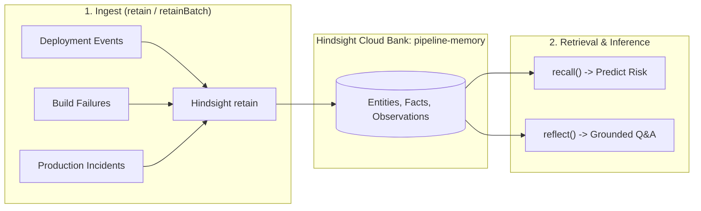

# Hindsight Memory Integration Architecture

> **Hackathon Submission Deep-Dive: How PipelineMemory leverages Hindsight**

PipelineMemory uses **[Hindsight](https://hindsight.vectorize.io)** as the central persistent memory layer that enables an AI agent to remember every deployment, learn from pipeline failures, and predict release risks before code reaches production.

---

## 1. Why Stateless AI Fails in DevOps

A generic, stateless LLM knows general best practices ("test your code", "avoid deploying on Friday"), but it has **zero context** about an actual engineering organization:
- It doesn't know that *your* `payments` service has a fragile database locking issue.
- It doesn't know that *your* developer Dave's deployments to the `gateway` have a 60% failure rate due to stale Docker caches.
- It doesn't know that a config change to `payments` previously cascaded into a 45-minute outage in `checkout`.

Without persistent memory, DevOps automation is blind. **Hindsight solves this by giving the agent long-term, cross-session episodic memory.**

---

## 2. Core Hindsight Primitives Used

PipelineMemory maps Hindsight's 3 primary primitives to DevOps lifecycle events:



### A. `retain` / `retainBatch` — Episodic Memory Ingestion
Whenever a deployment occurs, a build fails, or an incident is logged, PipelineMemory converts the event into rich natural language and retains it into the `pipeline-memory` bank.

```javascript
// backend/src/services/hindsightService.js
await client.retain('pipeline-memory', 
  `Deployment #61: db_migration change to payments service by pranay. ` +
  `Status: failed. Error: Deadlock detected during ALTER TABLE partition lock acquisition. ` +
  `Root cause: Unindexed foreign key references blocked active transactions. Fix: set lock_timeout=2s.`
);
```

### B. `recall` — Semantic Similar-Incident Retrieval
When an engineer proposes a new change (e.g. `service: payments`, `lines: 800`, `change_type: db_migration`), PipelineMemory generates a natural-language query and calls `client.recall('pipeline-memory', query)`:
- Returns semantically related historical incidents.
- Feeds into the transparent 6-factor risk scoring engine.
- Supplies real historical context to the LLM (Groq `openai/gpt-oss-120b`) to explain *why* the change is risky.

### C. `reflect` — Conversational Memory Synthesis
When querying the agent in the **Ask Agent** interface, PipelineMemory uses `client.reflect('pipeline-memory', question)`:
- Hindsight synthesizes observations across dozens of past deployments.
- Explains recurring patterns (e.g., Friday migrations, schema collisions, Docker cache staleness) directly from historical facts.

---

## 3. Side-by-Side Proof: With Memory vs Without Memory

| User Question | Stateless LLM (Without Memory) | PipelineMemory (With Hindsight) |
|---|---|---|
| *"Why did payments fail?"* | Gives generic advice about credit card declines, expired cards, and fraud detection. Completely irrelevant to internal DevOps infrastructure. | Recalls Deployment #61 & #62: identifies `ALTER TABLE` deadlock on unindexed foreign keys, notes that payments config changes carry a 60% failure rate cascading into checkout, and cites the 18-minute resolution. |
| *"Predict risk for payments migration"* | Suggests generic checklist: "Make backups and test." Score: Arbitrary. | Identifies 80% Friday failure pattern, cites past lock contention on Deployment #56 & #61, flags 3-service blast radius, and provides targeted canary advice. |

---

## 4. Key Takeaway for Judges
PipelineMemory is not a chatbot with prompt-injected history. It is an **autonomous, learning DevOps agent** where Hindsight acts as the persistent cognitive layer that prevents real outages before they happen.
